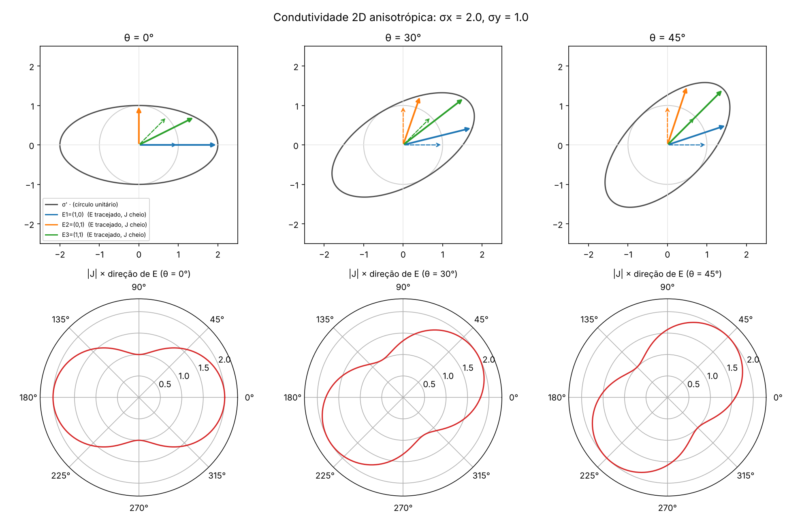
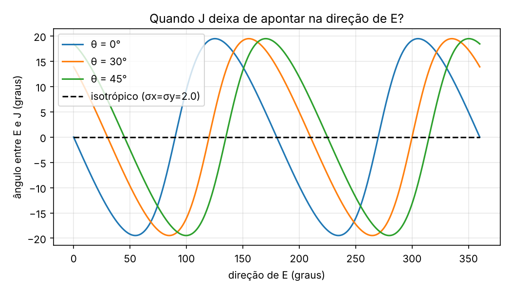

# Tópico 1: como explicar o Hands-On

[Índice](../README.md) · [Teoria](../teoria/01_tensores.md) · [Notebook](../../topic01_tensors/hands_on_01.ipynb)

## Em 30 segundos

"Estudei um material em que a corrente não segue o campo elétrico. Ele é descrito por um tensor σ. Ao girar o tensor, as componentes mudam, mas o traço e o determinante não. A corrente só fica paralela ao campo quando o campo está sobre um eixo principal."

## O problema

$$\mathbf J=\sigma\,\mathbf E,\qquad\sigma=\begin{pmatrix}\sigma_x&0\\0&\sigma_y\end{pmatrix},\qquad\sigma'=R(\theta)\,\sigma\,R(\theta)^{T}$$

Valores usados: σx = 2, σy = 1 e E = (1, 1).

## Resultado por resultado

**As componentes giradas.** Fazendo o produto e usando ângulo duplo, σ' fica igual à média das condutividades vezes a identidade, mais metade da diferença vezes uma matriz que gira com 2θ. A primeira parte é isotrópica; só a segunda sente a rotação. Por isso girar 180° já devolve o tensor original.

**Os invariantes.**

| θ | σ' | traço | determinante |
|---|---|---|---|
| 0° | [[2, 0], [0, 1]] | 3 | 2 |
| 30° | [[1,75; 0,433], [0,433; 1,25]] | 3 | 2 |
| 45° | [[1,5; 0,5], [0,5; 1,5]] | 3 | 2 |

Como Rᵀ = R⁻¹, σ' é semelhante a σ. Os autovalores continuam 2 e 1.

**A corrente.**

| θ | J | ângulo de E para J |
|---|---|---|
| 0° | (2; 1) | −18,43° |
| 30° | (2,183; 1,683) | −7,37° |
| 45° | (2; 2) | 0° |

Em 45° o vetor (1, 1) é autovetor de σ' com autovalor 2, então J = 2E.

**O desvio máximo.** Entre todas as direções de E, o maior ângulo entre J e E é arcsen((σx − σy)/(σx + σy)) = arcsen(1/3) ≈ 19,47°.

## Perguntas que podem fazer

E se σx = σy?

σ' = σx I para todo θ. J é sempre paralelo a E e a elipse vira círculo. Isotropia é invariância por rotação.

Qual a diferença entre girar o tensor e girar os eixos?

R σ Rᵀ gira o tensor em θ; Rᵀ σ R dá as componentes em eixos girados em θ. Diferem pelo sinal de θ. O slide usa a primeira.

σ é do tipo (1,1) ou (2,0)?

O slide classifica como (1,1). A rigor, se J é vetor e E é covetor, σ é (2,0). Em base ortonormal a lei de rotação é a mesma.

Por que a matriz é mais que um array de números?

Porque vem junto com uma base e uma lei de transformação. A aplicação E ↦ J é a mesma em qualquer base.

