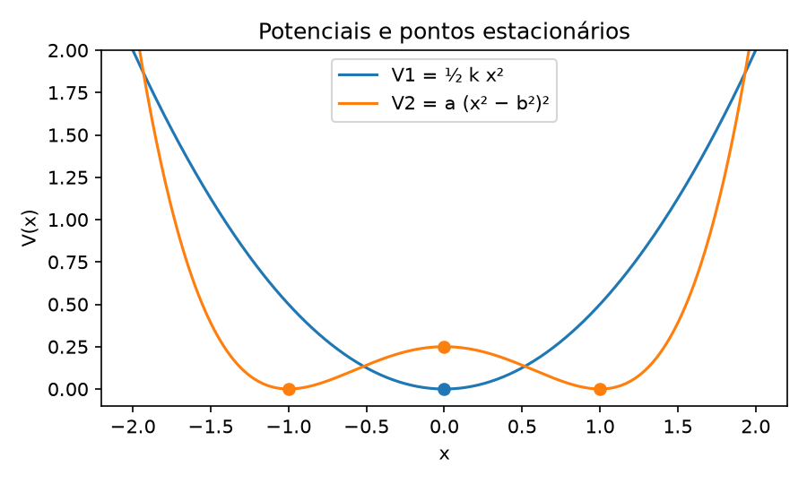
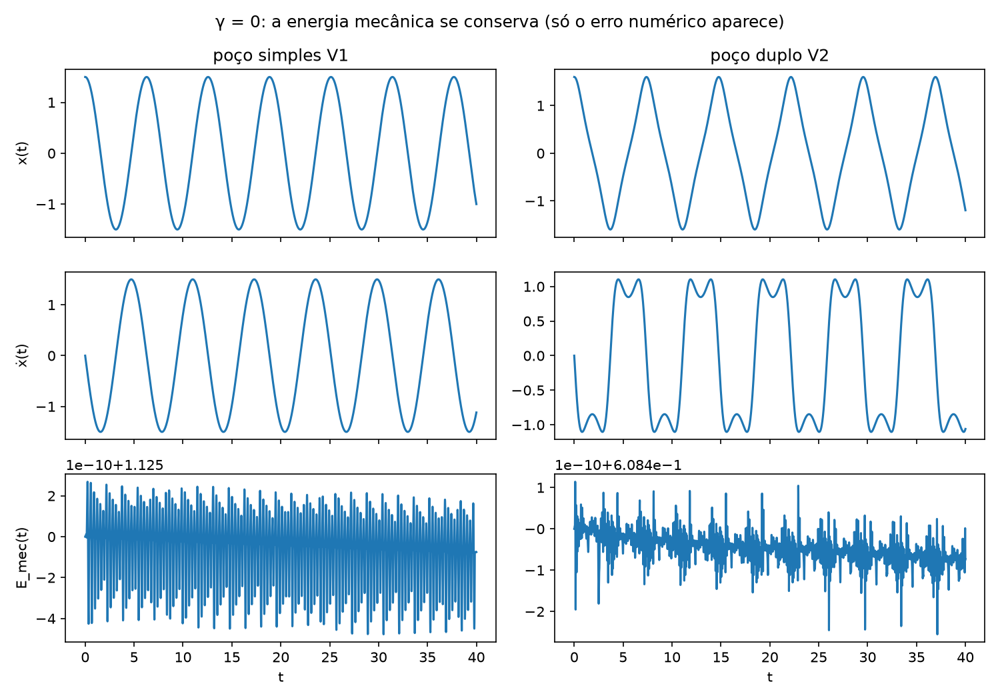
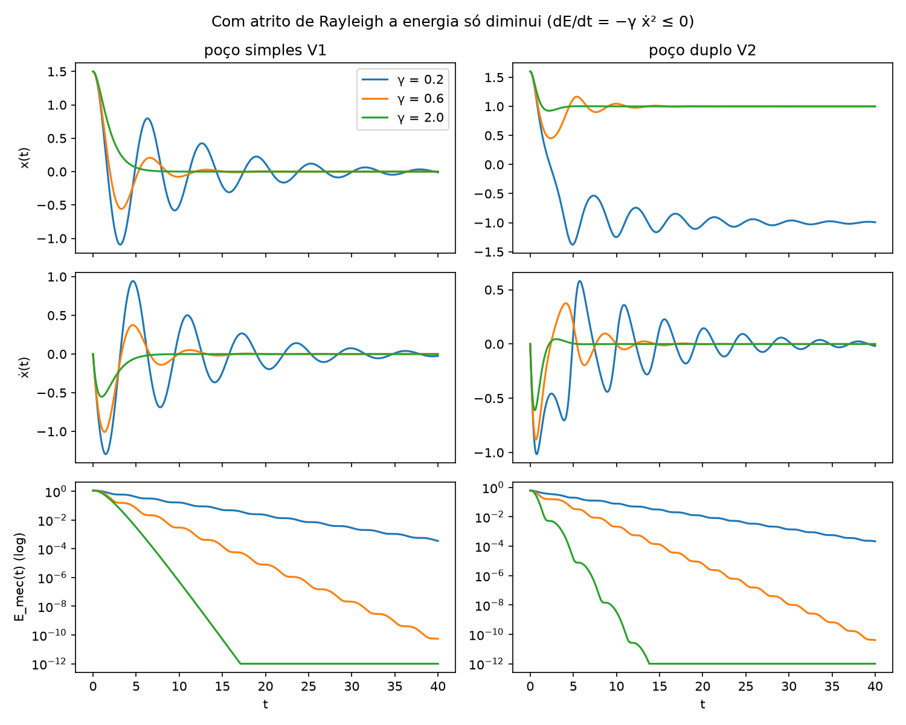
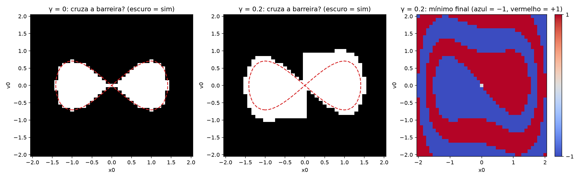
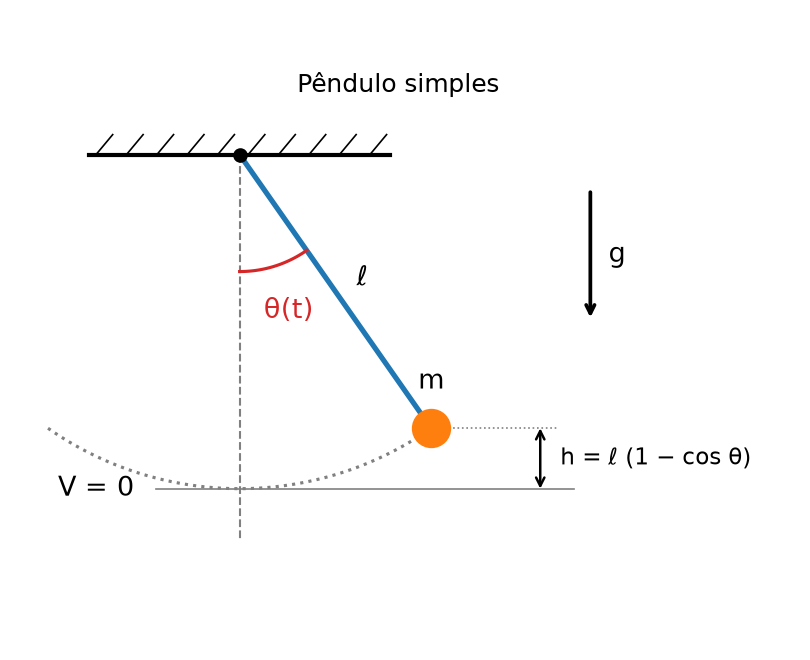
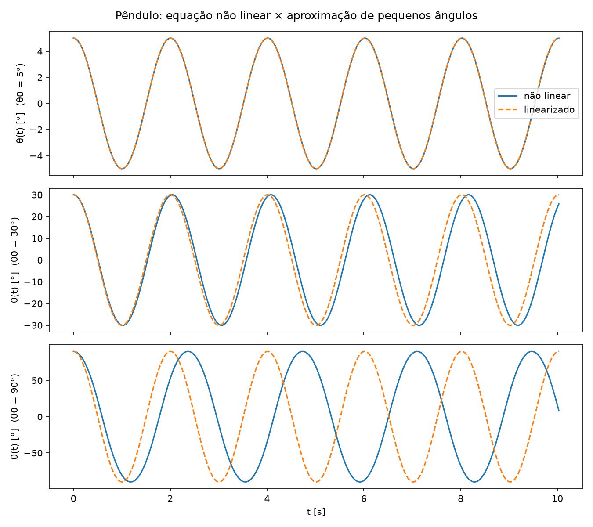
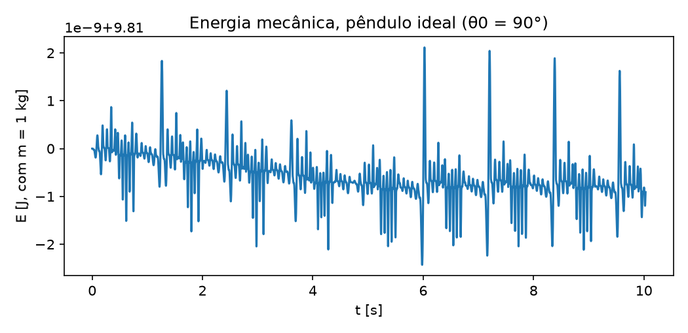
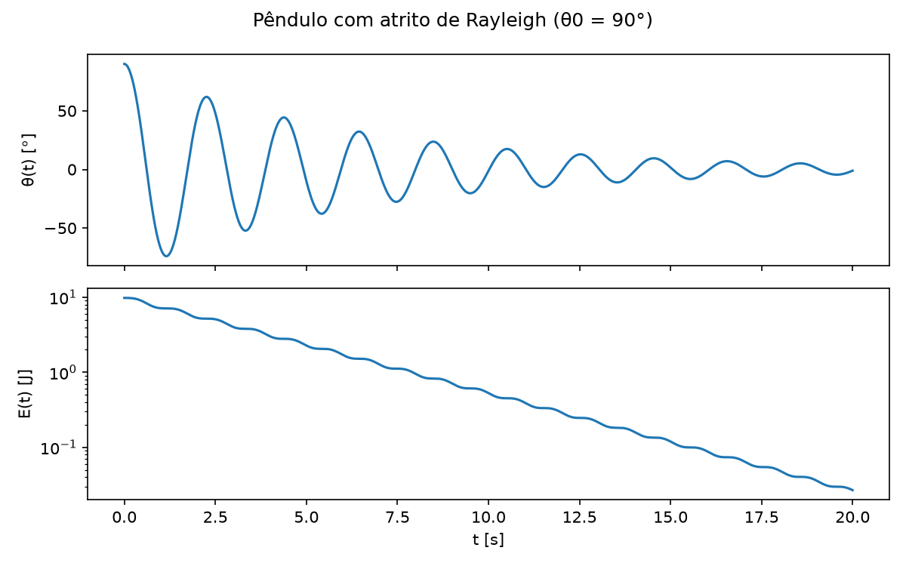

# Tópico 2: como explicar os Hands-On

[Índice](../README.md) · [Teoria](../teoria/02_calculo_variacional.md) · [Revisão](topico02_revisao.md) · [Código](../../topic02_variational/)

> Use este texto para **entender**. Para a entrega, reescreva as explicações dos itens 1.6, 2.7 e 3.7 com as suas palavras. Os números vêm da execução dos scripts em 25/11/2026.

**Sumário:** [O fio](#o-fio-que-liga-os-três) · [Hands-On 1](#hands-on-1-eulerlagrange-com-sympy) · [Hands-On 2](#hands-on-2-poços-de-potencial) · [Hands-On 3](#hands-on-3-pêndulo-simples)

## O fio que liga os três

1. **Hands-On 1:** a máquina. Dada uma Lagrangiana, o computador devolve a equação.
2. **Hands-On 2:** a máquina aplicada a poços de potencial, com e sem atrito.
3. **Hands-On 3:** o mesmo em um sistema real, testando até onde a aproximação linear vale.

---

## Hands-On 1: Euler–Lagrange com SymPy

**Em uma frase:** um sinal na Lagrangiana separa um sistema que foge do equilíbrio de um que oscila em torno dele.

**Função e funcional (1.1 a 1.3).** y(x) recebe um número e devolve um número. S[y] recebe a curva inteira e devolve um número. A rotina `euler_lagrange` calcula d/dx(∂L/∂y') − ∂L/∂y para qualquer L, e o script confere o resultado contra a função pronta do SymPy.

**Os dois testes (1.4 e 1.5).**

| Lagrangiana | Equação | Solução | Comportamento |
|---|---|---|---|
| ½y'² **+** ½ω²y² | y'' − ω²y = 0 | C₁e^(−ωx) + C₂e^(ωx) | foge do zero: instável |
| ½my'² **−** ½ky² | my'' + ky = 0 | senos e cossenos, frequência √(k/m) | oscila: estável |

Com L = T − V, o primeiro caso equivale a V = −½ω²y², um morro. O segundo é V = +½ky², um vale.

**1.6, a relação com a primeira variação.** Perturbe a curva por εη com as pontas fixas, derive a ação em ε, integre por partes. O termo de borda some e sobra a integral de um fator vezes η. Para dar zero com qualquer η, o fator é zero: essa é a equação de Euler–Lagrange. Passo a passo na [teoria, seção 3](../teoria/02_calculo_variacional.md#3-a-equação-de-eulerlagrange).

<details>
<summary>Pergunta provável: Euler–Lagrange garante que a ação é mínima?</summary>

Não. Ela garante só que a primeira variação é zero.
</details>

---

## Hands-On 2: poços de potencial

**Em uma frase:** sem atrito a energia decide por onde a partícula pode andar; com atrito, ela termina em um mínimo, e qual deles depende dos detalhes do começo.

Parâmetros: m = 1, k = 1, a = 0,25, b = 1.

### Os potenciais (2.1 a 2.3)



| Potencial | Ponto | V'' | Tipo |
|---|---|---|---|
| V1 = ½kx² | x = 0 | 1 | mínimo |
| V2 = a(x² − b²)² | x = 0 | −1 | máximo (barreira, altura 0,25) |
| V2 | x = ±1 | 2 | mínimos (V = 0) |

A equação é m ẍ + V'(x) = 0. Para integrar, vira o sistema ẋ = v, v̇ = −(V'(x) + γv)/m, resolvido com `solve_ivp` (DOP853).

### Sem atrito (2.4)



No poço simples o movimento é senoidal. No poço duplo, partindo de x = 1,6 em repouso, a energia é 0,6084, maior que a barreira, e a partícula visita os dois lados. A velocidade tem dois "ombros" em cada ciclo: é a perda de rapidez ao subir a barreira central.

A energia fica constante com desvio relativo de cerca de 4 × 10⁻¹⁰ nos dois casos. Esse resto é erro numérico.

### Com atrito (2.5)



A energia obedece dE/dt = −γẋ² ≤ 0. Quanto γ amortece depende da curvatura do poço onde a partícula se acomoda. A razão γ/(2√(mV'')) menor que 1 significa que ela oscila antes de parar.

| γ | Poço simples (V'' = 1) | Fundo do poço duplo (V'' = 2) | x(40) no poço duplo |
|---|---|---|---|
| 0,2 | 0,10: oscila bastante | 0,07: oscila | −0,99 |
| 0,6 | 0,30: oscila pouco | 0,21: oscila | +1,00 |
| 2,0 | 1,00: crítico | 0,71: ainda oscila de leve | +1,00 |

Com a mesma partida (x = 1,6), o atrito fraco deixa a partícula cruzar a barreira e parar no mínimo esquerdo. Com atrito maior, ela não sai do lado direito.

### Quem cruza a barreira (2.6)



**Primeiro mapa, sem atrito.** Escuro = cruza. Cruza quem tem E₀ = ½v₀² + V2(x₀) > 0,25. A curva tracejada é E₀ = 0,25, e o critério acerta 100% da grade.

**Segundo mapa, γ = 0,2.** A região que não cruza fica maior que a curva tracejada: ter E₀ > 0,25 é necessário, mas não suficiente. Das 1420 condições com essa energia, 1218 cruzam (85,8%) e 202 não; nenhuma sem essa energia cruza. "Cruzar" é trocar o sinal de x, então só partir de x₀ = 0 não conta.

O degrau em x₀ = 0 tem explicação: quem está à esquerda indo para a direita atravessa logo; quem já está à direita indo para a direita precisa ir, voltar e ainda ter energia para passar.

**Terceiro mapa, destino com γ = 0,2.** A cor diz em qual mínimo a partícula termina. Surgem faixas alternadas: cada faixa corresponde a um número diferente de travessias antes de ficar presa. Perto das fronteiras, uma mudança pequena no começo troca o destino. Isso **não é caos**: o movimento é regular e tem final definido; o que há é uma fronteira complicada entre as duas bacias de atração.

O ponto cinza no centro é x₀ = v₀ = 0: a partícula fica parada no topo da barreira, um equilíbrio instável.

### Mínimo de V não é mínimo da ação (2.7)

O mínimo de V é uma afirmação sobre **um ponto**: força nula e retorno após pequenos desvios. A ação é uma afirmação sobre **caminhos inteiros** em um intervalo de tempo, e só se garante que ela é estacionária.

Dois contrastes que convencem:

- Parada no **mínimo** de V2 (x = ±1): a ação deixa de ser mínima se o intervalo passa de π/√2 ≈ 2,22.
- Parada no **máximo** de V2 (x = 0): a ação é mínima local para qualquer intervalo.

A conta está na [teoria, seção 8](../teoria/02_calculo_variacional.md#8-estacionário-ou-mínimo).

---

## Hands-On 3: pêndulo simples

**Em uma frase:** a fórmula do período T₀ = 2π√(ℓ/g) é ótima para ângulos pequenos e falha em 90°.

### Montagem (3.1 a 3.4)



Uma só coordenada, θ(t). Com g = 9,81 m/s² e ℓ = 1 m:

| Grandeza | Valor |
|---|---|
| equação exata | θ'' + (g/ℓ) sen θ = 0 |
| equação linear | θ'' + (g/ℓ) θ = 0 |
| ω₀ | 3,1321 rad/s |
| T₀ | 2,0061 s |

### Linear contra não linear (3.5 e 3.6)



| θ₀ | T real (s) | T real maior que T₀ em | T₀ subestima T em | maior diferença de ângulo em 5 T₀ |
|---|---|---|---|---|
| 5° | 2,00702 | 0,05% | 0,05% | 0,071° |
| 30° | 2,04099 | 1,74% | 1,71% | 15,3° |
| 90° | 2,36784 | **18,0%** | **15,3%** | 178,8° |

As duas colunas de porcentagem medem a mesma diferença com referências diferentes: (T − T₀)/T₀ e (T − T₀)/T. Diga sempre qual está usando.

Um erro pequeno no período se **acumula**: em 30°, 1,7% vira 15° de diferença em cinco ciclos. Em 90°, as duas curvas chegam a ficar quase em oposição.

**Conferência.** O período medido na simulação coincide com o exato, dado pela integral elíptica T = 4√(ℓ/g) K(sen²(θ₀/2)).

> **Complemento.** Para ângulos moderados, T ≈ T₀ (1 + θ₀²/16), com θ₀ em radianos. Em 30° dá 1,71%, perto do valor exato.



A energia se conserva com desvio da ordem de 10⁻¹⁰. Repare na escala do gráfico: as oscilações visíveis são esse erro ampliado.

### Noether (3.7)

L(θ, θ') não depende explicitamente do tempo: fazer o experimento agora ou depois dá no mesmo. Essa simetria conserva H = θ' ∂L/∂θ' − L, que aqui vale T + V. Verificação direta: dH/dt é θ' vezes o lado esquerdo de Euler–Lagrange, que é zero.

Não há conservação do momento angular em torno do pivô, porque a gravidade escolhe uma direção.

### Com atrito (3.8)



Com R = ½bθ'² e b = 0,3 kg·m²/s, a amplitude cai e dE/dt = −bθ'². A curva de energia tem **degraus**: nos extremos do balanço a velocidade é zero e não há dissipação; no ponto mais baixo a perda é máxima. A conta numérica bate com a fórmula com erro máximo de 4 × 10⁻⁴, que vem da derivada por diferenças finitas.

<details>
<summary>Pergunta provável: por que o período cresce com a amplitude?</summary>

A força restauradora é proporcional a sen θ, que é menor que θ. Em ângulos grandes ela é mais fraca do que a aproximação linear supõe, e o balanço demora mais.
</details>

---

## Como reproduzir

A partir da raiz do repositório, um de cada vez:

```powershell
.\.venv\Scripts\python.exe topic02_variational/handson_1_euler_lagrange.py
```

```powershell
.\.venv\Scripts\python.exe topic02_variational/handson_2_potential_wells.py
```

```powershell
.\.venv\Scripts\python.exe topic02_variational/handson_3_pendulum.py
```
